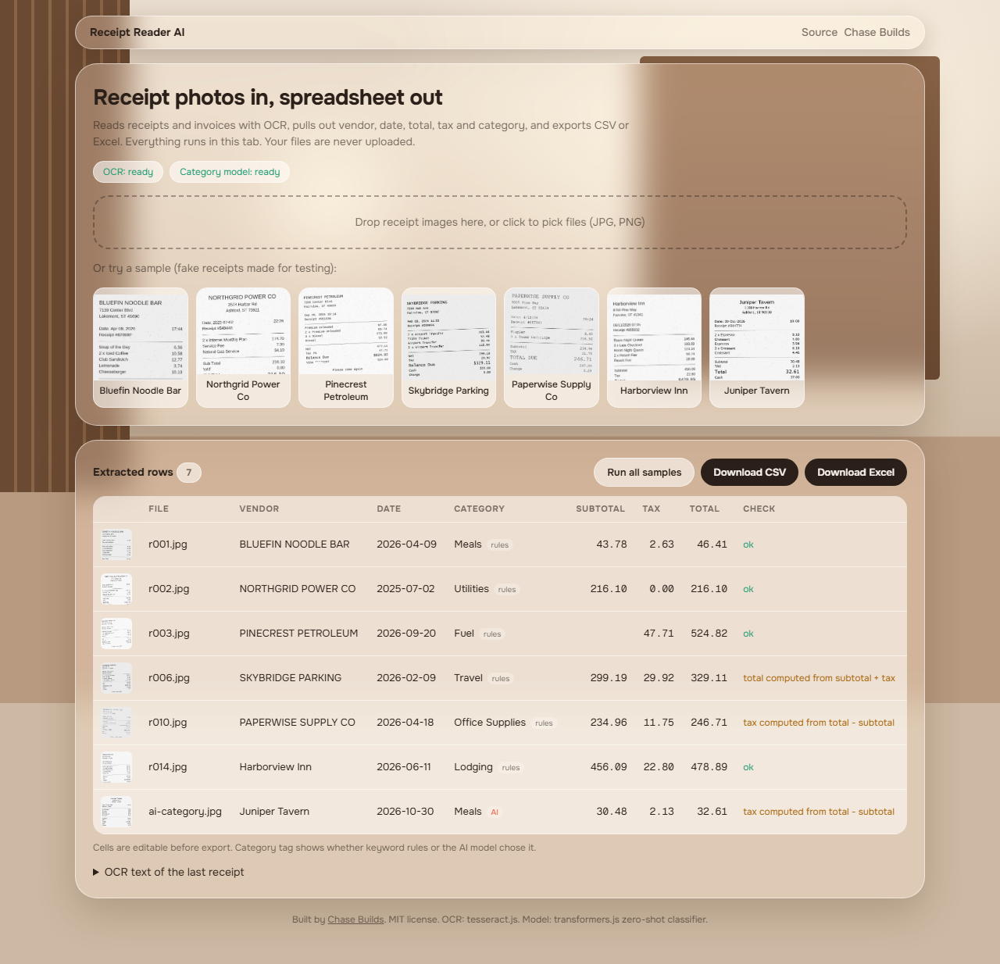

# receipt-reader-ai

[](https://github.com/chasebuilds/receipt-reader-ai/actions/workflows/ci.yml) [](https://github.com/chasebuilds/receipt-reader-ai/actions/workflows/pages.yml) [](LICENSE)

**[Live demo: try it in your browser](https://chasebuilds.github.io/receipt-reader-ai/)**. Click a sample receipt or drop in your own photos. OCR and the AI model run in the page, so receipts never leave your browser.

[](https://chasebuilds.github.io/receipt-reader-ai/)

Reads photos and scans of receipts and invoices and fills a spreadsheet: vendor, date, total, tax and expense category, ready to export as CSV or Excel.

Built for bookkeepers and small businesses doing expense reports. No account, no upload, no server.

## Measured result

The table below is written into this file by `npm run bench` from a real run. Per-receipt misses are in `bench/results.json`.

<!-- bench:start -->
Measured on synthetic receipt images made by `bench/generate.py` (12 fonts, 5 date formats, 6 total labels, rotation up to 2.5 degrees, blur and speckle noise). OCR by tesseract.js 5 (eng), category model `Xenova/mobilebert-uncased-mnli`. The rules were tuned on the dev set. The held-out set uses a different seed and was not tuned on.

| Field (exact match) | Held-out set (60) | Dev set (72) |
|---|---|---|
| Vendor (case-insensitive) | 100% (60/60) | 100% (72/72) |
| Date | 98.3% (59/60) | 100% (72/72) |
| Total | 100% (60/60) | 100% (72/72) |
| Tax | 98.3% (59/60) | 100% (72/72) |
| Category (rules, model when no keyword) | 100% (60/60) | 100% (72/72) |
| **Total within 1 cent** | 100% (60/60) | 100% (72/72) |
| All five fields right on one receipt | 96.7% (58/60) | 100% (72/72) |

Category on its own, held-out set: keyword rules 100%, zero-shot model alone 85%. The keyword list shares words with the generator, so the model-alone number is the fairer guess for real receipts.
<!-- bench:end -->

All test receipts are synthetic: fake vendors, fake amounts, rendered by the generator. Real phone photos (curled paper, shadows, faded thermal print) will be harder, which is why every row has an arithmetic check and every cell is editable before export.

## How it works

1. **OCR.** [tesseract.js](https://github.com/naptha/tesseract.js) turns the image into text in a Web Worker.
2. **Fields by rules.** `site/lib/extract.js` finds the vendor (first name-like line above the address), the date (five common formats, returned as ISO `YYYY-MM-DD`), the total (ranked labels: `GRAND TOTAL` over `AMOUNT DUE` over `TOTAL`, never `Subtotal`), and the tax line. Amount parsing tolerates the usual OCR damage, like `46. 41`.
3. **Arithmetic check.** If subtotal + tax does not equal the total, the row says so. If the total or tax line is unreadable, it is rebuilt from the other two and the row says that too.
4. **Category with a small model.** Keyword rules pick the category when the receipt has a clear word (`unleaded`, `room night`, `toner`). When none match, a zero-shot classifier ([`Xenova/mobilebert-uncased-mnli`](https://huggingface.co/Xenova/mobilebert-uncased-mnli) through [transformers.js](https://github.com/huggingface/transformers.js), about 25 MB, cached by the browser after the first visit) decides from the vendor name and line items. The table tags each category `rules` or `AI`.
5. **Export.** Edit any cell, then download CSV or `.xlsx` (SheetJS). Amounts are written as numbers.

Categories: Meals, Fuel, Office Supplies, Travel, Lodging, Utilities, Other.

## Run it locally

```
npm install
npm run serve          # http://localhost:4319
npm test               # unit tests
npm run e2e            # Playwright smoke test against the local site
npm run bench          # OCR + score both synthetic sets, updates the table above
```

Regenerate the test images (Python 3 with Pillow):

```
python bench/generate.py            # dev set, 72 receipts
python bench/generate.py holdout    # held-out set, 60 receipts, other seed
cd bench && python make_samples.py  # demo samples in site/samples
```

## Privacy

Images are read inside your browser tab. Nothing is sent anywhere. The page downloads only code and model files (tesseract.js, the English OCR data, the classifier weights) from public CDNs.

## Limits

- Tested on synthetic receipts only, in English, with US-style dates (month first) and dot decimals.
- Line items are not exported yet, only the header fields.
- Vendor is read from the top of the receipt. A receipt that opens with a logo image and no text name will give a blank or wrong vendor.
- Model category is a best guess from a small general-purpose model. On the held-out set it was right less often than the keyword rules (see the table), so check rows tagged `AI`.

## License

MIT. See [LICENSE](LICENSE).

## More from Chase Builds

- **[pdf-to-excel](https://github.com/chasebuilds/pdf-to-excel)**: Turns a folder of invoice PDFs into one Excel workbook with a confidence score on every field. ([live demo](https://chasebuilds.github.io/pdf-to-excel/))
- **[transaction-categorizer](https://github.com/chasebuilds/transaction-categorizer)**: Sorts bank and card transactions into categories and builds the monthly summary. ([live demo](https://chasebuilds.github.io/transaction-categorizer/))
- **[pii-redactor](https://github.com/chasebuilds/pii-redactor)**: Finds and masks personal info in CSV, Excel, text and PDF files. ([live demo](https://chasebuilds.github.io/pii-redactor/))

[All projects, sorted by industry](https://github.com/chasebuilds) · [chasebuilds.github.io](https://chasebuilds.github.io)
